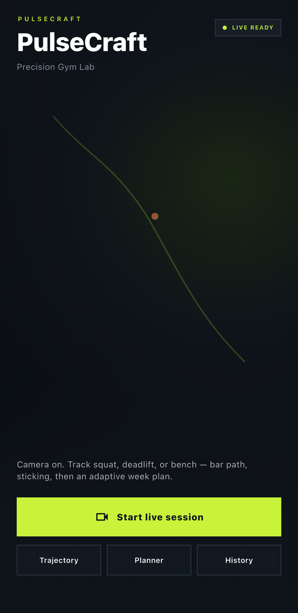
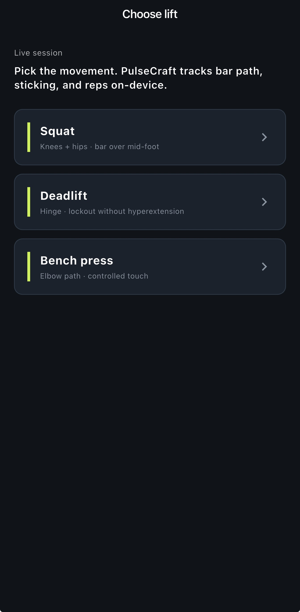
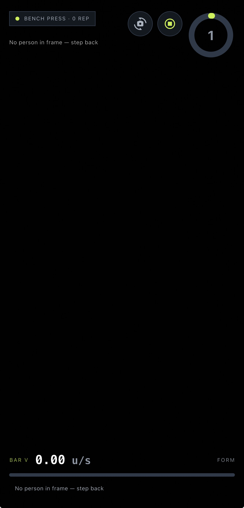

# PulseCraft AI

**On-device strength biomechanics for squat, deadlift, and bench press.**

PulseCraft turns a single phone camera into a live coaching instrument: pose estimation, bar-path visualization, sticking-point cues, velocity-based feedback, session scoring, and rule-based weekly plan adaptation — without requiring a network round-trip for the live set.

| | |
|---|---|
| **Platform** | Flutter (iOS / Android) |
| **Inference** | On-device (ML Kit Pose + TFLite FormScore) |
| **Backend** | FastAPI · WebSocket · Celery / Redis (archive & XAI) |
| **Version** | `0.4.1+24` |
| **License note** | See `DATA_LICENSE.md` for dataset terms |

---

## Overview

PulseCraft is designed as a **Precision Gym Lab**: low-latency visual feedback during the lift, structured review after the set, and light adaptation of the training week from session outcomes.

The live path is intentionally **device-local**. Camera frames never need to leave the phone for pose, scoring, or rep detection. Cloud services are reserved for optional archival sync, heavier video jobs, and post-set explanation workflows.

```
┌─────────────┐     ┌──────────────────┐     ┌────────────────────┐
│  Camera     │────►│  Pose + features │────►│  HUD / scoring     │
│  (Flutter)  │     │  (ML Kit / heur.)│     │  (path · VBT · FSM)│
└─────────────┘     └──────────────────┘     └─────────┬──────────┘
                                                       │
                                                       ▼
                                            ┌────────────────────┐
                                            │ SessionRepository  │
                                            │ + PlanAdjuster     │
                                            └────────────────────┘
```

---

## Product surface

| Module | Responsibility |
|---|---|
| **Exercise picker** | Select squat, deadlift, or bench before capture |
| **Live HUD** | Preview, skeleton overlay, bar-proxy trajectory, form ring, velocity ribbon, sticking indicator |
| **Session summary** | Aggregated form score, per-rep notes, path chart, coaching rationale sheet |
| **Trajectory lab** | Inspect and scrub stored session trajectories |
| **History** | Timeline of completed sessions with path replay |
| **Week planner** | Editable weekly focuses; updated after each finished session |

**Primary user flow:** Home → choose lift → live set → end session → summary → planner / history / lab.

---

## Screenshots

| Home | Choose lift | Live HUD (bench) |
|:---:|:---:|:---:|
|  |  |  |

Device captures — camera feed omitted in the live shot for privacy. Assets: [`docs/screenshots/`](docs/screenshots/).

---

## Technical design

### Mobile (`mobile/`)

| Concern | Implementation |
|---|---|
| Navigation | `go_router` |
| State | Feature screens + `flutter_bloc` where session events are needed |
| Capture | `camera` plugin; software frame path for reliable preview under custom iOS engine embedding |
| Pose | `google_mlkit_pose_detection` |
| Biomechanics | `PoseSessionAnalyzer` — rep finite-state machine, trajectory buffer, sticking trough, velocity proxy |
| Scoring | Bundled TFLite model (`assets/models/`) with heuristic fallback |
| Persistence | Local JSON (`SessionRepository`) |
| Adaptation | Deterministic `PlanAdjuster` rules from form / sticking / fatigue signals |

**Coordinate model.** Pose landmarks are 2D image-space. Depth used in coaching is a **torso-scale proxy**, not metric world coordinates. This is appropriate for relative path and sticking cues; it is not a substitute for multi-camera or depth-sensor laboratory capture.

### Backend (`backend/`)

| Component | Role |
|---|---|
| FastAPI | REST: health, sessions, videos, recommendations |
| WebSocket | Keypoint batch ingest (`/ws/sessions/{session_id}/keypoints`) |
| Celery + Redis | Asynchronous video / compute workers |
| ML package | Feature engineering, training, TFLite export, SHAP-style explanation templates |
| Storage / auth | Local store helpers; Firebase stubs for future identity |

Mobile HTTP/WebSocket clients currently expose stub interfaces. Wiring live capture to the backend is an integration step, not a blocker for the on-device product loop.

### Model artifacts (`artifacts/`)

| Artifact | Description |
|---|---|
| `form_score.tflite` | On-device FormScore export |
| `form_score_model.pt` / `form_score_state.pt` | PyTorch training artifacts |
| `metrics.json` | Holdout metrics from the last training run |

Training uses synthetic biomechanical feature vectors feeding a multi-head MLP (`FormScoreRegressor`). See `backend/ml/` for train / export / infer entrypoints.

---

## Repository layout

```
.
├── mobile/                 Flutter application
├── backend/                API, workers, CV helpers, ML training
├── shared/                 Cross-cutting docs and design notes
├── artifacts/              Model weights, metrics, train logs
├── data/                   Data assets and licensing
├── docker-compose.yml      API + Redis + worker
├── Makefile                Common backend / train commands
└── CONTRIBUTING.md
```

---

## Getting started

### Prerequisites

- Flutter SDK (3.3+ / Dart SDK per `mobile/pubspec.yaml`)
- Xcode (iOS) or Android SDK as needed
- Python 3.11+ recommended for backend / ML
- Docker (optional, for compose stack)

### Mobile

```bash
cd mobile
flutter pub get
flutter devices
flutter run -d <device_id>
```

Release install (iOS example):

```bash
cd mobile
flutter build ios --release
xcrun devicectl device install app \
  --device <UDID> \
  build/ios/iphoneos/Runner.app
```

Camera access is required. Live pose detection targets physical devices.

### Backend

```bash
# Development API
make api

# Test suite
make test-backend

# Train FormScoreRegressor
make train

# Containerized API + Redis + worker
docker compose up --build
```

Default API bind: `http://127.0.0.1:8000`.

---

## Quality & constraints

| Area | Current standing |
|---|---|
| Live big-three capture | Implemented on-device |
| Path, sticking, reps, local plan | Implemented |
| Summary / history / trajectory review | Implemented |
| Monocular metric 3D reconstruction | Out of scope for the phone path |
| End-to-end live cloud keypoint sync | Backend present; mobile client not connected |

Treat trajectory and sticking markers as **coaching signals** derived from monocular pose, not as instrumented laboratory ground truth.

---

## Disclaimer

PulseCraft AI is a **training and coaching aid**. It does not provide medical diagnosis, injury assessment, or clinical treatment recommendations. Always exercise judgment and consult qualified professionals when appropriate.

---

## Maintainers

See `CONTRIBUTING.md` for contribution notes. Portfolio context: `shared/docs/portfolio.md`.
